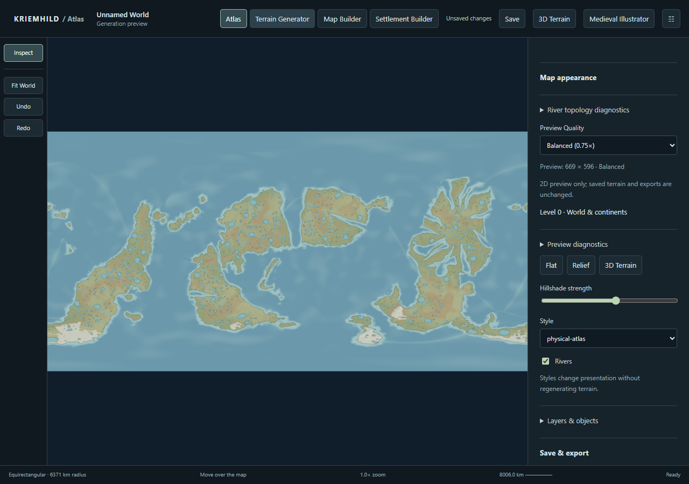
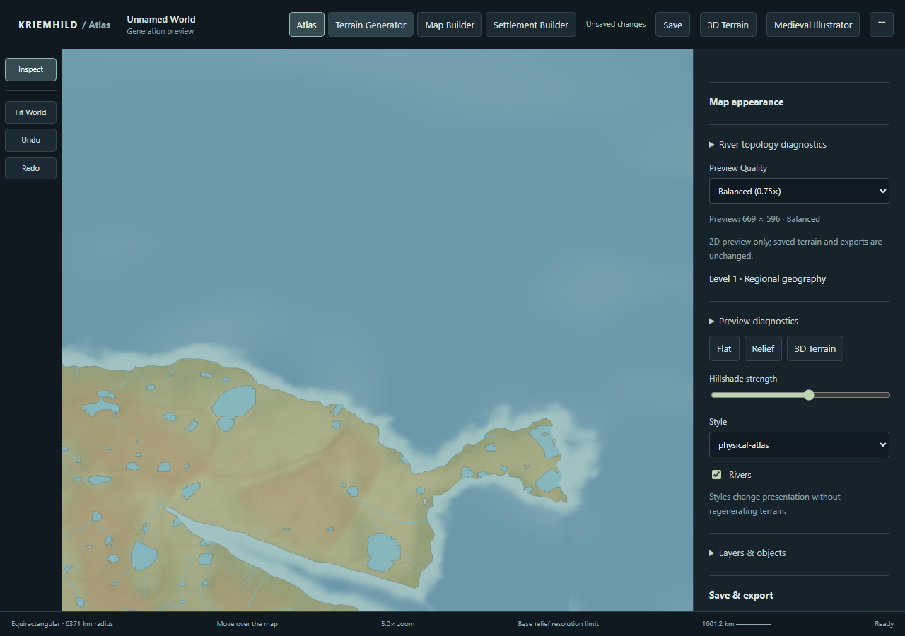

# Geographic preview and interaction

This work follows the source/archive baseline in [BASELINE.md](BASELINE.md).
No source grid, generation parameter, climate version or saved geography was
changed by the preview implementation.

## Shared workspace

Atlas's **Explore Atlas** action opens the same geographic workspace as the
Generator, Map Builder and Settlement Builder, in inspection mode. It retains
the tiled terrain API, geographic camera, overlays, and exact authored coordinates.
Collection thumbnails still use immutable saved snapshots. Builder navigation
does not regenerate a world. The existing authoritative settlement siting checks
and grouped undo/redo remain in use.

The new default **physical-atlas** style uses restrained elevation tints, moisture
variation, bathymetry, a separate relief layer, and simplified saved coasts and
river paths. It has no random pixel texture or additional terrain noise.
The existing `atlas` palette remains the Illustrator's independent style.

| Presentation | Camera width (world spans 2 units) | Visible geographic information |
| --- | --- | --- |
| 0: world/continents | >= .8 | Major rivers and broad physical relief |
| 1: regional | .15 to .8 | Regional rivers and more coast geometry |
| 2: local | .015 to .15 | All saved river classes and finer geometry |
| 3: editing | < .015 | Exact stored vertices and editing/selection context |

A 12% hysteresis band suppresses threshold oscillation. These levels are distinct
from tile LOD, source surface dimensions, and preview pixel density. Whole-feature
simplification preserves endpoints and every stored confluence. Features are
derived before viewport clipping; views never generate their own endpoints.
The existing source-resolution notice explains interpolation at excessive zoom.

Fast (0.5x), Balanced (0.75x), Detailed (1x) and bounded Custom remain local browser
preferences. Fast omits interactive hillshade and increases vector simplification.
The same quality preference is used in all four geographic workspace modes.
It is not persisted as part of terrain generation or world geography.

## Interaction and render scheduling

`GeographicQuery` converts map positions to wrapped longitude/latitude, queries
the authoritative sampler and authored operations, and rejects superseded clicks
and source revisions. Terrain colours are never queried. Selection feedback is
drawn immediately. The backend validates an optional requested revision and
returns the sampled revision. It captures immutable terrain and authored operations
under the session lock, then releases that lock before sampling. It does not
acquire a raster worker. The test fills all renderer slots and queries both poles,
the seam and the equator successfully while the slots remain occupied.

`FrameNavigator` composes rapid wheel/pan input into one pending camera per
animation frame. The existing 80ms render debounce, AbortController cancellation,
coarse-first pyramid and joined decode/atomic publication remain. Fine cache hits
bypass coarse rendering. The last coherent frame stays visible during replacement
or failure. Diagnostics distinguish first usable and final frames and report
revision, bounds, dimensions, cache state, cancelled/outstanding work and memory
estimates. Detailed fetch/decode/assembly/raster timings remain in the bounded
structured viewport log, without pointer-event logging.

| Cache/resource | Bound |
| --- | --- |
| Authoritative surfaces | Existing supported source widths, unchanged |
| Physical halo sample cache | Existing eight nodes, unchanged |
| Derived sampler indexes | Existing two worlds, unchanged |
| Simplified geographic geometry | 16 MiB estimated retained data; at most 24 entries |
| Client encoded raster cache | Existing 64 MiB LRU |
| Server encoded raster cache | Existing 64 MiB LRU |
| Geographic query results | 1 MiB; at most 256 entries |
| Output / assembly atlas | Existing 32 / 64 megapixel caps |
| Renderer concurrency | Existing three workers, unchanged |

Geometry cache keys include world/session, source revision, feature-array identity,
presentation level and simplification quality. This prevents caching an empty
initial feature response as the completed source. Byte estimates conservatively
include retained canonical river data. Query keys include exact coordinates,
world/session and revision. Raster version is bumped to `raster-3` for the new
palette. Local terrain invalidation and undo retain the existing raster dependency
checks. Edited landscapes explicitly mark saved climate/drainage analysis stale;
they do not silently rewrite the authoritative network.

## Hydrology diagnosis and representation

The observed seam gap was a **presentation defect**: both SVG path construction
and `riverFeatures` discarded the edge crossing +/-180 degrees. The new path
split interpolates an identical seam latitude on both sides and retains both
segments, even if one part previously had only one vertex. Round caps/joins avoid
hairline joins. The old test that expected a lost singleton segment now verifies
both boundary connections.

Scale filtering also caused **presentation defects** when a visible tributary's
downstream reach had a hidden class. Visible sets now include their downstream
and diversion-parent closure. Simplification locks confluences throughout the
trunk, rather than simplifying each display tile independently.

`terrain/hydrology` builds deterministic canonical reaches from the persisted
network. Trunks split at stored junctions and lake transitions. Each reach has a
stable source-feature/vertex ID, directed geometry, basin, discharge, source and
terminal node, with explicit incoming/outgoing node relationships. Sea and closed
basin terminals remain distinct; no basin is forced to drain to the sea. This is
a derived representation, not an import migration or automatic geometry snapping.
The feature API returns a graph revision/summary; `?topology=1` includes the graph.

Validation flags malformed samples, duplicate IDs, cycles, missing destinations,
mismatched confluences/basins, invalid mouths, water profiles, unexplained diversion
sources and deep cuts into original relief. The structured issue list is capped
at 200 entries while complete counts remain available. View clipping never
participates in terminal classification.

The independent deterministic audit is reproducible with:

```powershell
.tools/go/bin/go.exe run ./cmd/hydrology-audit
```

[Three-world results](hydrology-climate.json) use Kriemhild, gallery-001 and
gallery-002 at 1024x512 source resolution, terrain continuous-3, climate 1.
All three have **zero** missing destinations, mismatched confluences, water-profile
uphill edges, cycles and invalid sea mouths. They contain 716/578/1200 confluences.
This supports repairing presentation without inventing network connections.

Deep original-relief cuts (>100 m) remain: **1157 / 882 / 1482 sampled vertices**.
These diagnostics compare pre-carving relief to the channel water profile; they
are not a count of disconnected rivers. Current reduced macro drainage/carving
still needs physical validation before automatically rerouting those features.
The existing lake-footprint and reduced closed-basin models are not a full lake
water-budget or erosion simulation. This work does not claim those scientific
limitations are solved by styling or graph derivation.

Tests cover synthetic sloping plains/depressions, tributary topology, lake
transitions, explicitly modeled closed basins, seam/tile-independent paths,
all presentation levels, and preserved generated-world/archive connections.

## Independent biome investigation

The inspected sequence is latitude/tilt and reduced seasonal thermal forcing
(`climate.go`, experimental `thermal_seasons.go`), elevation transfer
(`surface.go`, `model/climate.go`), conserved atmospheric moisture and soil/PET,
monthly summaries (`biome.go`), orthogonal climate axes (`climate_regime.go`),
then vegetation and the published biome legend. Rendering samples this same
classification and does not use atlas colours as data.

The default climate version is still 1. Earlier validated investigations in
[deep-zoom](../deepzoom-investigation/REPORT.md) and
[preview/climate](../preview-climate-investigation/REPORT.md) document
elevation/seasonal model errors and limitations. Version 2 corrects atmospheric
elevation transfer; version 3 has experimental seasonal/orographic changes.
They remain explicit new-world options. Neither is promoted or applied on load.

The current audit independently reproduces desert area shares of **1.15%, 2.23%,
3.39%** for the three seeds; tundra is **9.60%, 5.35%, 14.09%**. These are the
existing diagnostic shares over emerged terrain, including inland water; they
must not be confused with a dry-land-only distribution. Latitude-stratified
shares and moisture residuals are recorded in the JSON. Maximum moisture-budget
residual is below 4.8e-13; conservation alone does not establish climate realism.
The complaint about biome balance is therefore a **climate/model calibration
issue still requiring validation**, not a problem solved by the atlas palette.
No biome quotas, classification thresholds or default climate behavior changed.

## Export isolation and verification

The Illustrator receives no preview quality settings and retains its own scene,
palette, export dimensions and terrain sampling. Builder exports now reconstruct
geometry independently of Fast simplification and remove selection feedback.
The hillshade export declaration is retained even when Fast does not render it.
Tests compare Illustrator scene output, authored coordinates and source data
across every preset, plus actual SVG exports in the browser audit.

The complete active Go suite, including HTTP, world and settlement tests, passes
with a 12m package limit (HTTP 246.788s, generation 180.929s). `go build ./...`
and `go vet ./internal/terrain/... ./internal/httpapi` pass. The initial full JS
run passed **109 tests**; a further native-frame receiver regression brings the
final clean-archive suite to 110 tests. Vite production build passes. `node scripts/check-ui.mjs` passes; the
aggregate `npm run check:ui` encounters pre-existing formatting differences in
untouched Biosphere.jsx and BiosphereEditors.jsx.

The collaborative browser opened successfully and allowed DOM inspection, but
snapshot calls failed and the host subsequently reported explicitly unavailable.
The recorded browser audit therefore uses local Playwright/Chrome on a disposable
database, not a claimed successful collaborative-browser screenshot run.

[Browser results](checks/browser.json) pass: four presentation levels, selection
in **297 ms** while two raster requests are delayed, **one render request for 50
wheel events**, preserved source/revision, and byte-identical 1024px SVG exports
across quality presets. Builder SHA-256 is
`0da24633b455bc5157a182fed534afdfd5776af53568192f731ffa2ea361d1d5`;
Illustrator SHA-256 is
`b35236de66c094a374871c25f25512e9167dd829301ab798f4a86705ee978447`.
These are disposable Chrome/DPR-1 observations, not hardware-independent timing
guarantees. The first harness run used an incorrect exact select label and timed
out; the second caught an unbound native animation-frame receiver. Both were
corrected before the passing run. The receiver now has an independent regression.





Final commit-archive verification is produced externally by `verify-source.mjs`
so that its commit hash and archive digest refer to the archived commit, without
a self-referential report changing that same commit. The original legacy-engine
full-suite timeout and the scientific limitations above remain explicit release
limitations; successful ZIP extraction is not a claim that those are solved.
