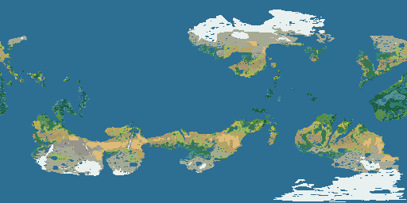
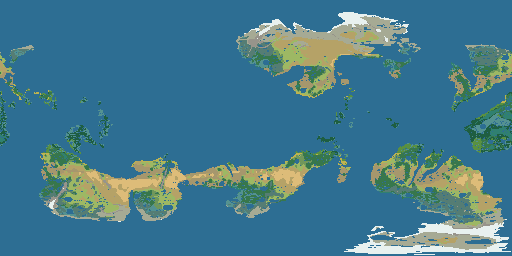

# Preview quality and climate investigation — 22 October 2026

## Decisions

**Adopt the adjustable 2D preview and single-image hillshade composition.**
Balanced (0.75×) is the default; Performance (0.50×), High quality (1.00×), and
Custom (0.50–1.50×) are available in **Map appearance → Preview Quality** in the
Terrain Generator, Map Builder and Settlement Builder. The actual requested
dimensions and any budget clamp are displayed. Preference storage is the
browser-level `kriemhild.preview-quality.v1` key, outside every terrain/world/Age
specification. Density is per CSS pixel, independently of screen DPR; this is an
explicit workload policy, not a claim of native retina density at 1.00×.

**Keep climate version 3 experimental.** It addresses demonstrated seasonal
temperature and atmospheric-orography defects, with the existing classifier.
It is not an entirely calibrated Earth climate model. Version 1 remains the
default; saved versions 0/1/2 retain their behavior. No saved user world was
migrated or regenerated.

Latest disposable [saved version-3 review world](http://127.0.0.1:8127/world/b8b2cfdc048623ddc28247b1ec4afb4c/build?tileDebug=1&world=8071df3ec4f577e21b747a0699864b17&age=acff67fe88e3419220c0dac432ed0290). To compare another
new world, open `/world/new` on port 8127, expand **Climate & scale**, select
**Version 3 — seasonal heat and rain uplift (experimental)**, enter a fixed seed,
generate, and select **biome** style. The displayed-version readout identifies
the visible terrain; changing the generation selector alone does not reclassify
a saved world. The original port-8124 backend was left running. It needs its
normal restart to load new Go code; the current review backend is on port 8127.

## Baseline and safeguards

Branch `rebuild/continuous-terrain`, HEAD
`2e4f5e4ede02b69e4cdba9c525212c6d7d827820`, with the preceding investigations'
uncommitted changes preserved. The active renderer is the atomic
`ViewportSurface`/`TerrainPyramid` path shared by all three builders.
`?terrainRenderer=tiles` remains an explicit diagnostic comparison only.

The saved clue is project `977d134ee5aadc480e1410ade3c84587`, seed `d1feae98-6510-4a72-951b-44e93a01ae86`,
continuous-3, climate 1, rainfall 1.65, relief 0.8, tilt 23.4°, radius 6371 km,
4096 × 2048 saved surface and 512 × 256 climate/drainage grid. The current
read-only database inventory still has zero `history_terrains` and `history_maps`
rows. Consequently this project is reproducible, but its relationship to the
unsaved preview behind history world `55815c1c9264170f1e4dc6076b0300a5` is
**not proven**. See [current history inventory](current-history.json).

The saved climate-1 baseline has forest 7.66%, woodland 2.55%, steppe 10.15%,
desert 5.57%, tropical rainforest 6.35%, temperate rainforest 2.88%, tundra
18.81% and ice 12.28% of cosine-weighted dry land. About 23.18% of dry land
lies at 45–60° absolute latitude; 62.40% of that band is tundra. These are
diagnostic observations, not desired biome quotas. See [saved baseline](saved-v1/d1feae98-6510-4a72-951b-44e93a01ae86.json).

All writes, edits, accepted worlds, restarts and cache rotations used disposable
copies under `.cache`. Original world data was never deleted. Preview changes do
not alter authoritative dimensions, source samples, climate grids, elevation,
river geometry, authored operations, resource storage or persistence formats.

## A. Confirmed preview causes and fixes

1. **Unconditional DPR multiplication was expensive.** The old 1200 × 800 CSS
   viewport requested 3600 × 2400 pixels at DPR 3. Balanced requests 900 × 600
   at all three tested DPRs, and selects its raster LOD using that density.
   Changing only the LOD ceiling would not address output/decoding costs.
2. **LOD 1 skipped a coarse frame.** Balanced's global view initially waited
   about 2.2 seconds without a fallback because the condition was `z > 1`.
   It now publishes a complete LOD-0 transaction before LOD 1. A complete fine
   cache still bypasses unnecessary coarse work.
3. **SVG hillshade blending retained large native-DPR GPU surfaces.** Reducing
   PNG density alone left the Balanced browser around 1.2 GiB in the initial
   controlled probes. Removing hillshade reduced that footprint; process
   measurements located the dominant allocation in the GPU process, with only
   about 31 MiB of JavaScript heap. The retained fix combines base and hillshade
   at preview raster dimensions into one opaque image against the existing
   `#101d2a` backdrop, then commits it atomically. Rivers, entities and editing
   controls remain vectors. Alpha/transparent-edge comparison against SVG
   multiply blending has **at most one channel-value error**; see
   [pixel experiment](preview-composite/pixels.json).
4. **Export worker completion order changed edge pixels.** Before correction,
   three SVGs had identical content after geographic image sorting, but different
   insertion order and different PNG hashes. Export now orders tiles by y/x and
   strips transient preview-generation/dimension attributes. All three quality
   presets produce byte-identical SVGs and byte-identical 1024 × 512 PNGs in the
   [export isolation test](preview-integration/results.json). Empty export-layer
   declarations preserve raw hillshade exports even when preview layers are
   combined or a replacement frame is pending.

Pipeline: SVG camera and CSS dimensions → `visibleViewport` (including
letterboxing) → explicit `previewRequest` → `visibleTiles` → `renderViewport` →
bounded `TerrainPyramid` → three-worker tile requests → backend three-slot
renderer and immutable physical halos → complete per-style atlases → preview
composition → joined image decoding → one React frame commit.

World/revision/style/configuration identity and cancellation remain enforced.
Shade strength participates in render identity. The previous complete frame
remains visible until a replacement is ready; obsolete callbacks cannot replace
a newer frame. A quality change reuses compatible raw pyramid nodes instead of
invalidating authoritative samples. The 32-megapixel viewport and 64-megapixel
atlas limits, three frontend workers, three backend detail slots, eight physical
nodes, 64-MiB client encoded cache, and existing server cache budgets remain.

### Repeatable timing results

Windows 10, four-core i5-6300HQ, approximately 16 GiB RAM, Intel(R) HD Graphics 530, Chromium 1243,
Node 24.21.0. [Hardware record](hardware.json). All timings below are medians of
two runs with the same seed, revision 0, exact camera, CSS dimensions 1200 × 800
and natural + hillshade styles. Cold runs use fresh browser caches, backend
processes **and persistent tile caches**. Coarse nodes can be reused within a
five-view sequence; individual response headers record actual hits/misses.
Warm runs immediately reuse the exact complete fine-node cache.

These are isolated render/PNG/bitmap-decode transaction timings, excluding
Studio's existing 80-ms debounce, React scheduling and final SVG compositor
paint. Actual Studio image decoding, layers, memory and interactions are checked
separately. Worker-stage sums and server timing sums are not wall-clock latency.

| DPR | View | Cold final ms: reference → Balanced | Warm final ms: reference → Balanced | Balanced first complete, cold ms |
|---:|---|---:|---:|---:|
| 1 | Global | 9,757 → 2,868 | 132 → 98 | 631 |
| 1 | Continental | 14,644 → 4,708 | 187 → 121 | 959 |
| 1 | Regional | 7,317 → 3,711 | 128 → 95 | 492 |
| 1 | Local | 4,817 → 4,595 | 82 → 96 | 705 |
| 1 | Beyond source cells | 3,083 → 2,956 | 68 → 71 | 267 |
| 2 | Global | 35,679 → 2,840 | 434 → 99 | 621 |
| 2 | Continental | 55,749 → 4,659 | 592 → 134 | 950 |
| 2 | Regional | 27,539 → 2,932 | 420 → 86 | 507 |
| 2 | Local | 17,944 → 4,607 | 283 → 86 | 706 |
| 2 | Beyond source cells | 11,059 → 2,957 | 231 → 66 | 267 |
| 3 | Global | 38,117 → 2,802 | 706 → 101 | 617 |
| 3 | Continental | 58,654 → 4,644 | 884 → 135 | 960 |
| 3 | Regional | 27,480 → 2,933 | 587 → 86 | 489 |
| 3 | Local | 58,601 → 4,590 | 780 → 99 | 705 |
| 3 | Beyond source cells | 41,057 → 2,956 | 643 → 66 | 266 |

At some DPR-1 zooms the same integer raster LOD is selected. In those cases cold
sampling dominates and output scaling alone barely changes latency. The warm
DPR-1 extreme case is also slightly slower with preview composition. The GPU
memory reduction is a separate benefit; there is no claim of universal speedup.

Data: [final matrix](preview-final), [reference cold measurements](preview-cold/results.json),
[retained Balanced cold measurements](preview-cold-final/results.json),
[natural-only cold/warm measurements](preview-cold-natural/results.json).
Every run includes bounds, pixels, raster LOD/node size, styles, stage timings,
HTTP status/size/timing/cache headers, cancellation counts and encoded/cache bytes.

### Browser memory

Fresh browser per case, two repetitions, actual DPR 1/2/3 contexts, 1920 × 1080
window, same initial camera/style and **same pristine backend** for both
frontends. Startup camera is overridden before any terrain render. These are
aggregate OS working sets of that browser's processes, excluding the Go backend;
shared process pages can be counted more than once. Maximum observed includes
periodic simultaneous samples and the post-GC sample, not an exact instantaneous
peak. Screenshot allocation occurs after measurements.

| DPR | Working set after GC: reference → Balanced | Maximum observed: reference → Balanced |
|---:|---:|---:|
| 1 | 1,248 → 597 MiB | 1,318 → 662 MiB |
| 2 | 1,322 → 590 MiB | 1,469 → 656 MiB |
| 3 | 1,628 → 594 MiB | 1,687 → 661 MiB |

[Raw samples, process IDs, graphics configuration and frame sizes](preview-memory-final/results.json).
Browser memory remains hardware/driver dependent; larger raster buffers do not
explain the entire browser footprint. No cache budget was increased.

### Geographic and export isolation

The setting never changes the geographic camera, pointer transform, zoom anchor,
source terrain or vector river geometry. Runtime quality changes, a delayed
obsolete request, a terrain edit while rendering, Undo/Redo and preference reload
pass the [integration test](preview-integration/results.json). Landmark and town
coordinates remain unchanged through camera movement in the
[builder audit](builders/audit.json) and
[settlement audit](builders/settlement-audit.json). The explicit setting is used
only by 2D previews; 3D terrain retains its separate configuration.

The Map Illustrator ("Medieval Illustrator" in this UI) receives no preview
configuration and keeps native DPR/output settings. Its raw layers stay
synchronized; [runtime isolation proof](preview-final/ui.json) includes the
Custom 1.50× case followed by Illustrator activation. Exports rebuild raw layers
at `exportWidth` and DPR 1, independent of preview density or composition.

Matched captures: [global reference](matched-previews/reference-global.png) /
[Balanced](matched-previews/balanced-global.png),
[regional reference](matched-previews/reference-regional.png) /
[Balanced](matched-previews/balanced-regional.png),
[extreme reference](matched-previews/reference-extreme.png) /
[Balanced](matched-previews/balanced-extreme.png).
[Capture bounds/revisions](matched-previews/results.json) also cover continental
and local views. The source-resolution tooltip remains: about 9.77-km relief
sample spacing at 4096 × 2048. A 0.00008-wide view is about 1.6 km at the equator;
magnification and finer raster pixels cannot invent additional relief. Existing
rivers and authored geometry can be finer. No residual-noise experiment was
connected to production.

## B. Climate causes, experiments and comparisons

**The defect begins before vegetation classification.** At 55° and 100 m height,
the old monthly equation's warmest month is 7.266°C at a 20-km coast distance and
8.760°C at 2000 km. Both are below its own tree-growing threshold. Version 3
changes only the seasonal anomaly to a periodic response to solar forcing and
land/ocean heat capacity, with reversed hemispheric seasons, inland amplitude,
thermal lag and continuous coastal transitions. The prior annual-mean latitude
and maritime terms are retained. The final coastal control reaches 10.470°C;
the inland control reaches 24.208°C. Elevation cooling and negative-seabed
invariance pass independently of vegetation.

**Atmospheric uplift incorrectly included the sea floor.** Changing only the
synthetic ocean from −100 m to −4000 m changed maximum annual precipitation by
20,153.260 mm. Version 3 uses positive atmospheric heights for uplift, lee relief
and its derived slope/exposure. The same test then has exactly zero difference,
while a real above-sea-level ridge retains a rain shadow and conserves water.
Logs: [before](orography-before.txt), [after](orography-after.txt).

No aridity, desert, grassland, rainforest, Mediterranean, alpine or boreal
classification threshold changed. No biome-area quota or spatial paint/smoothing
was introduced. The existing biome palette and API legend share the same
`BiomeColors` identifiers. Tropical and temperate rainforest remain distinct.

The attempted ocean evaporation cap is **rejected**, not hidden in the final
candidate: reference-vegetation PET is not a calibrated ocean energy budget, and
the strict cap substantially over-dried the complete-world test. Monthly water
budgets now expose ocean/land evaporation, ocean reference demand,
precipitation and atmospheric storage separately. See
[experiment ledger](EXPERIMENTS.md), [cap before](evaporation-before.txt),
[rejected cap outcome](candidate-v3-evaporation/d1feae98-6510-4a72-951b-44e93a01ae86.json).

### Seven paired seeds

Same continuous-3 generator, 4096 × 2048 source dimensions and Earth-like settings.
Numbers are cosine-latitude-weighted shares of **dry land**, excluding ocean and
grid lake cells, estimated at 512 × 256 sites. Every diagnostic records that
denominator and separate lake coverage. Table values are version 2 → version 3;
the original saved world remains version 1.

| Seed | Forest | Tropical rainforest | Temperate rainforest | Steppe | Desert |
|---|---:|---:|---:|---:|---:|
| Kriemhild | 11.13 → 22.24 | 14.53 → 12.27 | 6.01 → 6.03 | 7.84 → 7.24 | 1.39 → 1.12 |
| gallery-001 | 9.63 → 21.16 | 20.55 → 16.75 | 8.23 → 7.95 | 5.72 → 4.45 | 2.66 → 2.71 |
| gallery-002 | 6.05 → 12.51 | 13.32 → 10.91 | 4.51 → 5.00 | 9.39 → 12.57 | 4.02 → 3.80 |
| 8fef5907901a | 10.17 → 19.16 | 11.25 → 9.29 | 4.18 → 3.89 | 10.29 → 10.26 | 6.01 → 6.13 |
| gallery-003 | 8.54 → 16.66 | 14.61 → 12.70 | 5.03 → 4.84 | 8.38 → 9.43 | 3.04 → 3.28 |
| gallery-004 | 11.23 → 19.67 | 8.13 → 6.33 | 4.26 → 4.05 | 8.47 → 11.81 | 1.35 → 1.09 |
| Saved seed | 7.34 → 13.73 | 7.60 → 6.00 | 3.33 → 2.94 | 10.20 → 15.78 | 5.53 → 5.71 |

Version-2 biome shares match the preceding investigation **exactly for all seven
seeds**. Version-0 temperature equations and version-1 classification are covered
by frozen-oracle/compatibility tests. Source generation/export formats are retained.

Some steppe increases because previously cold-limited land now has a viable
growing season but remains moisture limited. A lower rainforest percentage is
not, by itself, evidence of realism. For the retained saved-seed candidate,
ordinary forest rises but forest component count also rises: absolute largest
forest region grows, while its fraction of all forest falls. Full connectivity
statistics are available; spatial coherence is not declared completely solved.

**Paired geography caveat:** the existing `landmass.Conditioned` function uses
climate moisture for fine gullies/dunes. Thus new climate can change final fine
bed samples even with the same seed/settings; hydrology also responds. Coasts and
roughness have identical hashes across versions in all seven runs, but beds and
lake levels differ. Those are existing generation dependencies, not preview
resolution changes. We did not alter conditioning or drainage algorithms.

### Frozen saved-surface comparison

An opt-in, offline diagnostic re-simulates weather on the same saved relief,
projects it using the existing version-2 atmospheric-height convention, and
preserves authoritative bed/coasts/roughness, rivers, lake levels and grid water/
drainage fields. It never writes the user database or creates a migration path.
The dry-land denominator is identical: 0.247484633541 of the
globe. [Version-2 proof](fixed-surface-v2/proof.json),
[version-3 proof](fixed-surface-v3/proof.json), and field checksum files confirm
the geometry is unchanged.

| Dry-land biome | Frozen-surface climate 2 | Frozen-surface climate 3 |
|---|---:|---:|
| forest | 7.25% | 13.85% |
| woodland | 2.59% | 3.56% |
| grassland | 6.33% | 10.91% |
| steppe | 10.09% | 15.39% |
| desert | 5.60% | 5.76% |
| rainforest | 7.62% | 6.02% |
| temperate-rainforest | 3.32% | 2.92% |
| taiga | 1.29% | 8.55% |
| tundra | 18.75% | 7.55% |
| ice | 12.17% | 2.51% |




Each full-world/frozen-world directory contains annual field maps, 12-month
temperature and rainfall atlases, PET/aridity/soil/slope/elevation maps,
growing/freezing/dry-month maps, warm-season rainfall/PET and cold-season rain
share, independent thermal/moisture/rainfall regimes, latitude/coast/elevation
tables (including joint latitude/coast groups), per-biome causal fields and
component statistics. Growing months use monthly temperature >10°C; measured
dry months use precipitation <half monthly PET. The fixed monthly atlas scales
and raw numeric statistics should be used together, especially for very wet cells.

### Persistence and remaining physical limits

The UI sent climate version 3, generated the documented seed, accepted it only
into the disposable store, then reopened the same version and exact terrain
sample. A stopped/restarted backend reopened it with **zero generation jobs** and
the same sample: [UI proof](climate-ui/results.json),
[cold restart](climate-ui/cold-restart.json). Active Go tests cover persisted
monthly fields and historical-Age isolation for versions 2 and 3.
A second independent [fresh UI acceptance](climate-ui-repeat/results.json)
also saved and reopened version 3 with the identical specification and sampled
terrain/climate. One earlier acceptance run timed out before navigation; its
cause remains unconfirmed. The two instrumented retries succeeded, so this is
recorded as a remaining acceptance-flow risk rather than a claimed fix.

The seasonal candidate uses the response formulation/parameters cited in the
[experiment ledger](EXPERIMENTS.md), not the original paper's fully calibrated
circulation model. Annual mean heat transport, directional maritime/ocean-current
effects, cloud/snow/ice feedbacks, lake heat storage, ocean evaporation and PET
energy calibration remain reduced approximations. Coastal sites with identical
coast distance/elevation are not thermally distinguished by west/east exposure.
These limits, and unresolved fragmentation/biome calibration, are why version 3
is experimental and the saved climate-1 world is not reported as repaired.

## Changed implementation and regression coverage

Preview: `src/continuous/preview-quality.js` (validated preference and budgets),
`preview-composite.js` (bounded color composition), `ViewportSurface.jsx`
(explicit configuration, atomic publication, export declarations),
`terrain-pyramid.js` (LOD-1 fallback, publication metrics/abort guard),
`Studio.jsx` (shared controls, displayed version, explicit Illustrator bypass,
deterministic independent exports). No generic/export renderer reads the preference.

Climate: `generate/climate.go` (versioned seasonal/orographic fixes and budget
terms), `thermal_seasons.go` (seasonal response), `model/model.go` (explicit
experimental maximum 3 and optional budget metadata), `cmd/climate-audit/main.go`
(causal maps/statistics/checksums). `fixed_surface_audit_test.go` is an opt-in
diagnostic only. The vegetation classifier is unchanged by this workstream.

Validation: **100 JavaScript tests passed**, active `internal/terrain/...` and
`internal/httpapi` Go suites passed, final targeted thermal/fixed-surface tests
passed, `go vet` passed, production build passed. Added coverage includes preset/
custom safety and persistence, coordinate/source-cache invariance, obsolete
quality/opacity publication, complete LOD-0 fallback, transparent-edge composition,
export equality, pending edits, version compatibility and persistence, seasonal
forcing, atmospheric height and genuine rain shadows. Browser builder/settlement
tests cover placement, zoom/pan, retry, edits, Undo/Redo, reload and export.

Historical failed harness runs are retained in the experiment record. They are
not counted as passing final evidence: an obsolete injected tile should not be
retried, a disappearing OS process should not fail memory collection, a
cross-port diagnostic proxy must preserve Origin/Host rules, and initially
different saved views cannot support a controlled memory comparison.

## Reproduction

Use a disposable consistent SQLite backup containing the documented project;
never clear a user cache/world to create a benchmark. `.cache/quality-climate-20261022`
serves the review UI and `.cache/preview-cold-data` is the separate pristine
reference fixture. Install/use the repository's normal Node dependencies and Go
toolchain. Test scripts accept the documented environment variables; the browser
executable used here is under `ms-playwright/chromium-1243/chrome-win64`.

```powershell
npm.cmd test
.tools/go/bin/go.exe test ./internal/terrain/... ./internal/httpapi
npm.cmd run build
# Full disposable workflow (climate generation takes several minutes):
powershell.exe -NoProfile -File tests/preview-climate-validate.ps1
# Freeze the saved surface for a non-migrating climate comparison:
$env:KRIEMHILD_FIXED_SOURCE = '<extracted metadata/fields directory>'
$env:KRIEMHILD_FIXED_OUT = '<new disposable output directory>'
.tools/go/bin/go.exe test ./internal/terrain/generate -run TestFixedSurfaceClimateAudit -count=1 -v
```

Benchmarks: `preview-quality-run.mjs` uses `KRIEMHILD_AUDIT_URL` for the pristine
backend, `PREVIEW_UI_URL` for the real preview UI, and `PREVIEW_AUDIT_OUT`.
`preview-quality-cold.mjs` archives only its checked disposable cache path before
each process; `PREVIEW_COLD_PRESETS`, `PREVIEW_COLD_STYLES` and `PREVIEW_COLD_OUT`
select a subset without changing production code. `preview-quality-memory.mjs`
uses separate current/reference UI builds on ports 8127/8128 and routes both to
the pristine backend. `preview-reference-build.mjs` disables only the explicit
preview preference prop in a generated diagnostic build; it never edits source.
`preview-quality-captures.mjs` reproduces exact camera captures.

The final manifest records source/build hashes and the working tree. No PR,
deployment, automatic user-world migration or local-refinement rollout was made.
