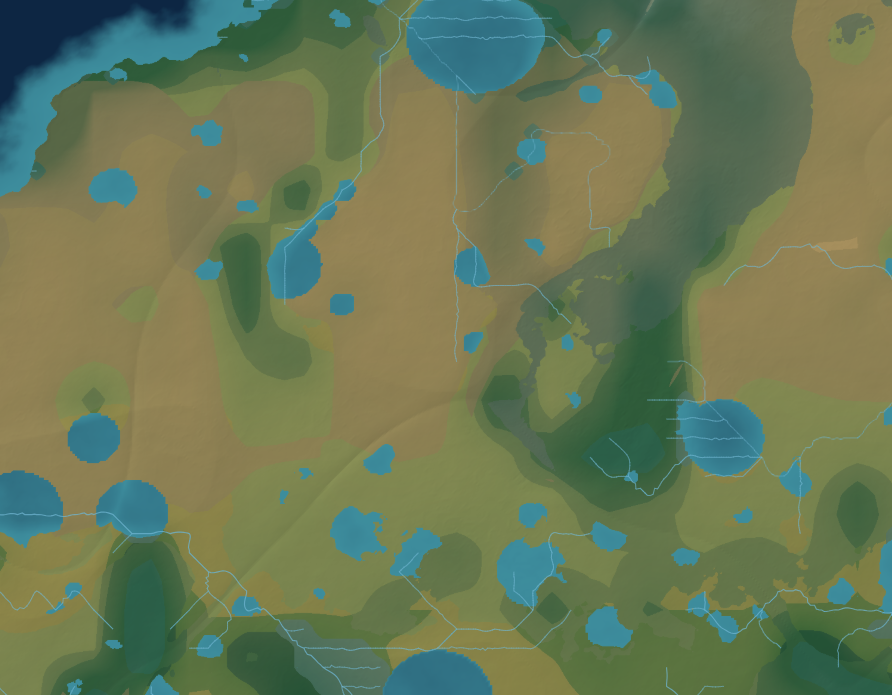

# Terrain rendering and climate investigation

Investigated 22 October 2026 against `rebuild/continuous-terrain`, starting at `685011a`. Fetched `origin`; its `main` merge (`a79e54b`) had the same source tree. All experiments used the active `continuous-3` pipeline. Source resolution remains 4096×2048; frontend workers and backend detail slots remain three. No existing user world was deleted or regenerated. Browser edits used an isolated server and disposable data under `.cache/terrain-investigation` on port 8125; the existing server on 8124 was left alone.

The reproducible rendering defect was missing detail coverage in the visible SVG margins. Independent tests also confirmed stale revision reuse, nonrecovering transient failures, and eviction of visible tiles on large/high-DPI screens. Climate investigation found both an overly cold maritime temperature field and classification errors involving seasonality and early returns. These were repaired separately, retaining the existing renderer, moisture transport, hydrology implementation, biome identifiers, and geographic placement conventions.

**Reproduction and before/after evidence**

The original fixture is world `47d7f3ae6edf78298c34a8b8f334ae6f`, seed `Kriemhild`, Earthlike defaults, climate version 0, terrain revision 0. Browser viewport: 1280×800; SVG rectangle: `(88,70,892,695)`. Initial camera: `0 0 2 1`. Six zoom steps around 42% across/40% down the SVG reached:

```text
x = 0.7620343104171656   y = 0.3127600712541041
w = 0.18252779440611827  h = 0.09126389720305914
```

The same saved surface, revision, camera, and SVG dimensions were used for the direct visual comparison:

| Before | After |
| --- | --- |
|  |  |

These two images are raster captures of the actual SVG, including its loaded images, not full browser screenshots. Native preview screenshot capture failed; the later full-browser captures used headless Chromium after the collaborative preview explicitly reported that no automation host was available.

The nominal camera covered y=0.31276–0.40402, but `xMidYMid meet` exposed y=0.28728–0.42950. The loader never requested some of this visible geography. Of 2,173 screen sample points, **742 lacked the finest requested level** in the baseline; the corrected capture has **zero uncovered sample points**. Coarse parent images remained visible indefinitely, so coastlines and vegetation appeared to stop at rectangular detail boundaries. This depended on camera position, aspect ratio and zoom, rather than a fixed damaged geographic cell. Reloading could change cached fallback imagery but could not repair the selection calculation. [Baseline state and requests](baseline-zoom.json), [corrected state](after-zoom.json), [computed comparison and image hashes](comparison.json).

An independently injected HTTP 503 left the original client at “Tile loading failed” without retrying. The repaired client recovered from the same class of failure without refresh. [Original failure](baseline-failure.json), [subsequent browser request log](browser/audit.json).

The later 13-stage browser sequence covered gradual/rapid zoom, horizontal/vertical pan, zoom out/return, Map Builder placement, a +300 m terrain edit, exact undo, Settlement Builder, reload and repetition. All stages reached Ready with zero missing detail samples and no JavaScript page errors. Revisions increased during these authored-edit tests; they are not the revision-0 image comparison above. The [browser log](browser/audit.json) records cameras, images, revisions, request times/statuses/headers and available body sizes. There were 69 normal aborted requests and one deliberately injected 503, which recovered. Some intercepted/cancelled response bodies are unavailable or reported as zero bytes; do not interpret those as empty accepted PNGs.

Additional settlement testing verified the site click against the requested longitude/latitude, centered the preview on that site, accepted all generated features, and verified unchanged stored geographic coordinates after zoom/pan. [Settlement assertions and exports](browser/settlement-audit.json), [site screenshot](browser/14-settlement-site.png), [zoom/pan screenshot](browser/15-settlement-zoom-pan.png), [SVG export](browser/settlement-export.svg), [PNG export](browser/settlement-export.png). A new full-resolution climate-version-1 world was also generated, accepted, saved and reopened successfully in 59.6 seconds including browser interactions and rendering. [New-world result](browser/new-climate-world.json), [screenshot](browser/16-new-climate-world.png).

**Request-to-display trace and tested hypotheses**

World coordinates are x∈[0,2], y∈[0,1]. At level z, span s=2⁻ᶻ, with 2ᶻ⁺¹ columns and 2ᶻ rows. SVG image bounds are `[xs,ys,s,s]`. Backend pixel centers use longitude `−π + π(x+(i+½)/size)s` and latitude `π/2 − π(y+(j+½)/size)s`. Thus frontend edges and backend samples agree; adjacent tiles share exact geographic edges. The backend sampler wraps longitude; the editor displays one finite world and clamps tile addresses rather than duplicating the world horizontally.

`camera.js` now derives the actual visible rectangle using `scale=min(svgWidth/camera.w, svgHeight/camera.h)`, the same scale used for entity placement. `TileSurface` selects that rectangle, orders requests near the camera center, requests immediate parents first, deduplicates tile addresses within the queue, and starts three workers after the existing 80 ms debounce. Parents use `(z−1,floor(x/2),floor(y/2))`. Images remain sorted by increasing z, so loaded children cover their corresponding parent regions.

Each request carries address, size, style, revision and `strict=1`. The server snapshots the surface and relevant authored operations, validates revision, checks its content cache, waits for one of three detail slots, checks cache again, renders PNG and returns its revision. Server identity includes source identity, address, size, style and relevant-operation hash. Physical samples use the immutable planet, address, size and a one-pixel halo. Client identity includes source/session identity, revision lineage, local dirty-rectangle stamp, address, size and style. A result is published only while its request remains active and its revision header matches.

| Hypothesis | Evidence and disposition |
| --- | --- |
| Incorrect image coordinates, parent sizing or SVG order | Synthetic coordinate and component tests pass. Retained the established rectangles and ascending-z compositing. The confirmed error was **visible-area selection**, not image placement. |
| Parent fallback itself is invalid | A deliberately delayed child remains covered by its parent while neighboring children load; release replaces the correct region. Retained fallback. |
| Failed requests leave permanent coarse rectangles | Confirmed with one 503 before repair. Added three bounded attempts, 15-second attempt deadlines and 250/750 ms abortable backoff for network errors, 408, 429 and 5xx. Permanent errors and revision mismatch stop; obsolete camera work never retries. Exhausted failures remain reported, and a subsequent viewport/revision request can try again. |
| Frozen `baseRevision` permits stale imagery | Confirmed by changing revision without dirty rectangles: previously all old URLs survived. Now reuse requires a complete contiguous history of local dirty rectangles; unknown revisions reset lineage immediately. A one-pixel halo is included when intersecting dirty bounds. Strict requests reject stale revision snapshots. Unaffected local tiles still reuse valid content. |
| Fixed 192-entry cache can evict current geography | Confirmed at 4096×2048/DPR 3: 512 required children previously lost 320 entries despite Ready. Current children and immediate parents are pinned; only reusable, unpinned entries are evicted. |
| Frontend/backend 2:1 convention disagrees | Ruled out for the tested transformations. Corrected an extra right/bottom edge request independently using exclusive upper bounds; that over-request was not the primary seam. |
| Independent sampling or shading creates geographic seams | Shared halo samples agree within 1e−8 for elevation, temperature and precipitation; water and biome agree exactly, including the longitude seam. A parent at 512 pixels equals four children at 256 at every pixel in natural, biome, mask, elevation, hillshade and shore-ink styles. No sampler rewrite was justified. |
| Three workers/slots or source resolution causes the defect | No evidence of spontaneous server errors causing the baseline margin failure. Backend cancellation while all slots are occupied releases promptly. Kept concurrency and full source resolution. Added queue/render `Server-Timing` instrumentation. |

The parent/child pixel comparison deliberately uses equal geographic sample density; different resolutions can legitimately differ in antialiasing or simplification while preserving geographic location.

**Climate diagnosis, changes and measured outcome**

Three full-resolution seeds used identical defaults: `Kriemhild`, `gallery-001`, `gallery-002`; landCoverage .32, relief .8, rainfall 1.65, tilt 23.4°, radius 6371 km. Diagnostics use the existing 512×256 climate grid, weighted by cos(latitude). Final biome/field/connectivity statistics exclude both ocean and lake water. JSON contains annual and all 12 monthly temperature, precipitation and PET distributions; aridity, seasonal range, slope/elevation, rain shadow and exposure; 15° absolute-latitude bands; and contiguous-region statistics. They are climate-grid measurements, not a census of every source pixel.

The baseline was **not globally too dry**: median annual rainfall was 1,111 / 1,531 / 620 mm, and median precipitation/PET was 1.08 / 1.29 / 1.13. Regions of genuine aridity coexist with wet regions. Monthly variation already existed. The evidence supported specific temperature-field and classification defects, not a wholesale replacement of rainfall transport or arbitrary biome shares.

1. At ±50.625°, a controlled 100 m maritime site had annual −0.33°C and warmest month 3.69°C: no viable forest season. Continentality damped coastal summers without moderating this cold annual mean. A reduced maritime heat-redistribution term, `8*(1−continentality)*sin(2*latitude)^2`, now tapers inland and toward equator/poles. The same site has annual 7.15°C and warmest month 11.17°C. The inland control retains a larger 23.05°C seasonal range; hemisphere seasons reverse; tropical convection, rain shadow and moisture-budget tests still pass. This is an explicit reduced-model approximation, not a calibrated ocean-current simulation. Poleward heat redistribution is physically motivated, but the 8°C coefficient is a modeling choice, not a measured universal constant. [Ocean Heat Transport](https://www.aoml.noaa.gov/phod/docs/Macdonald.pdf).
2. The old classifier returned desert/steppe/cold classes before its seasonal refinements. It treated cool 1,100 mm/year land as rainforest because PET was low, and a 22°C annual mean as tropical despite cold winters. It classified winter-wet/summer-dry 450 mm/year land as steppe and a negative annual mean with a viable summer as tundra or ice. Controlled tests reproduced these separately.
3. New classification evaluates growing-season cold limits, persistent aridity, Mediterranean summer drought, moisture limitation, wetlands, tropical warmth/moisture, boreal conditions and temperate vegetation. Tropical rainforest requires all-month warmth and sustained rain; temperate rainforest requires at least 1,800 mm/year, suitable temperatures and no pronounced dry season. Mediterranean seasonality precedes steppe but not true desert. Alpine outcomes require cold growing seasons and elevation, with exposure/slope extending the transition; warm highlands can retain forest. Existing aridity boundaries (.22/.50/.80) and existing biome IDs remain. Monthly climate distinctions follow established climate-classification principles; this vegetation classifier is not an implementation of the complete Köppen system. [Beck et al., 2023](https://pmc.ncbi.nlm.nih.gov/articles/PMC10593765/).

Seven summaries are computed from persisted monthly fields, refreshed after elevation resampling, and sampled lazily during classification. This avoids scanning all 12 months per rendered pixel. No arbitrary biome patches, area quotas or spatial smoothing were introduced.

Percent of **dry land**, before → after:

| Biome | Kriemhild | gallery-001 | gallery-002 |
| --- | ---: | ---: | ---: |
| Temperate forest | 8.40 → 11.90 | 8.75 → 11.11 | 4.25 → 6.56 |
| Woodland | 3.82 → 4.99 | 4.19 → 3.77 | 1.76 → 2.60 |
| Mediterranean shrubland | 3.44 → 8.56 | 3.10 → 7.38 | 1.37 → 5.80 |
| Steppe | 14.34 → 7.83 | 9.75 → 5.67 | 12.66 → 9.51 |
| Desert | 2.32 → 1.35 | 3.28 → 2.65 | 5.72 → 3.97 |
| Tropical rainforest | 14.57 → 13.12 | 19.94 → 17.45 | 12.92 → 12.01 |
| Temperate rainforest | 4.40 → 5.05 | 5.80 → 6.74 | 3.75 → 4.01 |

Temperate rainforest **increased slightly overall**, because more maritime land now has suitable temperatures, despite the stricter classifier. Woodland also does not increase in every seed. The result is not a uniform reduction of every reported dominant category.

Forest in the 30–45° bands increased from 6.33→16.43%, 10.52→16.67%, and 4.69→12.44% of dry land within each band. At 45–60°, it increased from zero to 3.34%, 6.69%, and 3.90%. The largest connected forest region increased from .354→.747%, .435→1.005%, and .409→.708% of total dry land. Region counts changed 264→283, 261→248, and 185→231: larger connected regions are demonstrated, but not universally fewer fragments. A controlled smooth moisture gradient produces five connected vegetation bands, and uniform fields remain uniform.

Global emerged-land fractions remain approximately 27.00%, 22.43% and 26.67%. Lake fractions change from 3.66→4.03%, 3.42→3.58%, and 3.57→3.94% of the globe because the changed climate feeds existing hydrology. Hydrology algorithms were not changed; new-world lake/routing differences are an expected downstream effect, not evidence of identical new terrain.

Final comparable evidence: [before](climate-before/Kriemhild.json) / [after](climate-final/Kriemhild.json), [gallery-001 before](climate-before/gallery-001.json) / [after](climate-final/gallery-001.json), [gallery-002 before](climate-before/gallery-002.json) / [after](climate-final/gallery-002.json). Each directory includes six maps per seed: biome, temperature, precipitation, aridity, seasonality and elevation. The earlier `climate-baseline`, `climate-temperature-only`, and `climate-after` directories preserve the sequential experiments but used an emerged-land denominator that included potential vegetation over lakes. Do not mix their percentages with the final dry-land table.

**Changed files and compatibility**

| Files | Purpose |
| --- | --- |
| `src/continuous/camera.js`, `Studio.jsx` | Actual SVG width/height coverage, exclusive tile bounds; all terrain layers receive height. Placement transforms unchanged. |
| `src/continuous/TileSurface.jsx`, new `tile-request.js` | Revision lineage, working-set cache pinning, bounded recovery/cancellation, revision checks and opt-in diagnostics. |
| `internal/httpapi/continuous.go` | Queue timing and current climate version for new generation jobs. Existing content cache retained. |
| `internal/terrain/generate/climate.go`, `biome.go`, `surface.go` | Targeted maritime temperature term, monthly vegetation rules and precomputed seasonal summaries. |
| `internal/terrain/model/model.go`, `codec.go`, `src/continuous/api.js` | Optional climate identity and defaults; validate/persist the additional fields. |
| `cmd/climate-audit/main.go` | Repeatable fixed-seed climate, connectivity, map and performance diagnostics. |
| New/extended camera, tile-request, TileSurface, HTTP, tile-continuity, seasonal-biome and climate tests | Reproductions and regression coverage on the active pipeline. |
| `tests/*investigation*` scripts and this directory | Repeatable browser exercises and recorded evidence. |

`continuous-3` remains the generator version. Optional `climateVersion:1` identifies new climate semantics; absent/zero retains the exact prior temperature and classifier path. Source identity includes the specification. Old saved worlds do not silently acquire new biomes. All 18 diagnostic PNGs regenerated with climateVersion 0 match their original pre-change SHA-256 hashes. [Hash record](comparison.json).

The codec keeps the old field limit for old archives and permits seven additional summaries for the new climate version, requiring both summaries and monthly fields. An intermediate archive round-trip failure exposed the old 64-field limit; the bounded extension and validation repaired it. World/Age, natural-resource and authored-entity schemas are unchanged. Existing archives remain readable; archives using the new climate fields require this updated application and are not promised to open in older binaries.

**Regression and performance results**

| Check | Result |
| --- | --- |
| `npm.cmd test` | 80 passed, including actual server restart/archive round trip. |
| Focused camera/component/request tests | 16 passed: margin coverage, map bounds, delayed children, order, revision, cache pressure, retries, deadlines and cancellation. |
| `go test ./... -timeout 5m` | All active packages passed. Untouched `internal/legacyterrain` timed out at five minutes in `TestSeparatedFoundationsAtMultipleScales`; the baseline timeout is already documented in the repository README. The overall command therefore exits nonzero. |
| Targeted new climate tests | Seasonal classification, uniform/gradient coherence, maritime symmetry and existing rain-shadow test passed. |
| Archive/compatibility | Continuous ZIP, cold restart, large wet-planet budget and deterministic persistence tests passed; deterministic persistence was rerun after the final codec cleanup. |
| `go vet ./...`, production build | Passed. |
| UI checks | `node scripts/check-ui.mjs` and formatting of all changed frontend/test files passed. Global `npm run check:ui` stops on pre-existing formatting in untouched `Biosphere.jsx` and `BiosphereEditors.jsx`. |
| Browser | All 13 main stages, accepted settlement placement/export, and new climate generation/save/reopen passed. |

Logs are in [regression](regression/). The broad Go suite ran before the final additional gradient/maritime assertions and codec-loop cleanup; those changes were covered by subsequent targeted runs. Full JavaScript tests and build were rerun last.

| Measurement, before → after | Kriemhild | gallery-001 | gallery-002 |
| --- | ---: | ---: | ---: |
| Full 4096-wide generation, seconds | 36.95 → 37.47 | 39.47 → 40.14 | 43.57 → 40.69 |
| Cold z6/54/22 natural tile, ms | 480.3 → 582.6 | 118.4 → 92.5 | 82.6 → 58.5 |
| Warm physical-cache render, ms, two repeats | 19.0–20.5 → 21.0–22.0 | 14.0–15.0 → 12.5–13.0 | 12.5–13.0 → 12.5–13.0 |
| Live Go heap after GC, MiB | 198.8 → 206.1 | 474.5 → 490.7 | 745.6 → 770.4 |

Heap measurements are sequential within each three-seed process: bounded sampler caches retain earlier planets, so later rows are **not per-world memory requirements**. The extra climate fields add about 3–4% to the measured live heap. The first seed's cold tile is 21% slower; two others are faster. These single-machine observations include different newly generated river/lake workloads and are insufficient to claim universal performance equivalence. Timings for generation stages and every measured render are in the seed JSON files.

The original viewport could report completion while visible detail remained absent; the repaired viewport finishes complete. It necessarily fetches additional tiles for previously uncovered margins. The later browser sequence had 799 cache-hit responses among 962 request records; it is longer and much warmer than the original 144-record sequence, so their latency distributions are not a controlled speed comparison. High-DPI cache pinning also uses more memory when the visible working set exceeds 192 entries. It stays bounded by active viewports plus the reusable cache; lowering resolution to hide this cost would reintroduce the placement-quality tradeoff the task explicitly rejected.

**Reproduction commands and remaining limits**

From the repository root, use the bundled Go executable on Windows where `go` is not on PATH:

```powershell
./.tools/go/bin/go.exe run ./cmd/climate-audit -climate-version 0 -out .cache/climate-before
./.tools/go/bin/go.exe run ./cmd/climate-audit -climate-version 1 -out .cache/climate-after
npm.cmd test
./.tools/go/bin/go.exe test ./internal/terrain/... ./internal/httpapi -timeout 5m
npm.cmd run build
```

For browser reproduction, run a disposable server, set `KRIEMHILD_AUDIT_URL` and `KRIEMHILD_AUDIT_WORLD` to its saved fixture, then run `node tests/run-continuous-investigation.mjs` and `node tests/run-continuous-settlement-investigation.mjs`. These intentionally author fixture entities and terrain edits. `node tests/run-climate-generation-investigation.mjs` creates a separate new world. Set `KRIEMHILD_BROWSER_EXECUTABLE` only when Playwright's default browser is unavailable. `?tileDebug=1` labels tile bounds/address/revision and records at most 1,000 request lifecycle events in `window.__terrainTileLog`.

Remaining limits: three default-config seeds and Chromium do not cover every preset, extreme climate configuration, browser or device-memory budget. The maritime correction has no explicit ocean currents or conserved atmospheric/ocean energy budget; high latitudes remain comparatively cold. Very wet precipitation extremes and substantial lake coverage remain properties of the underlying model. Existing broad biome identifiers represent mixed/deciduous forest, montane vegetation and shrubland without introducing a species-level vegetation model. No claim is made that every world resembles Europe or contains every biome. Bounded retries deliberately stop after persistent failure; the UI reports failure rather than falsely claiming high-resolution completion. The legacy Go timeout and unrelated UI formatting failures remain unresolved.
