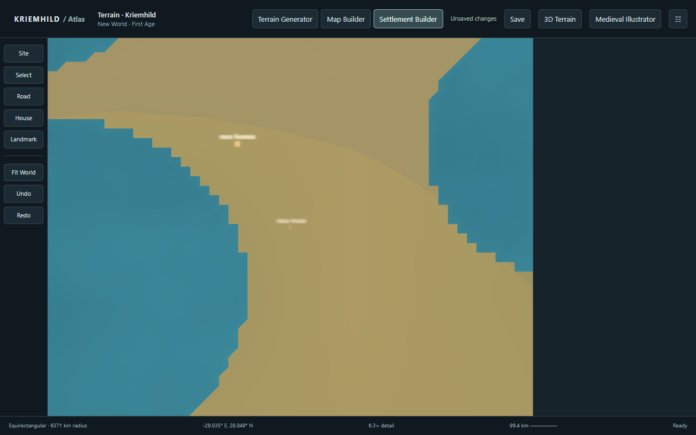
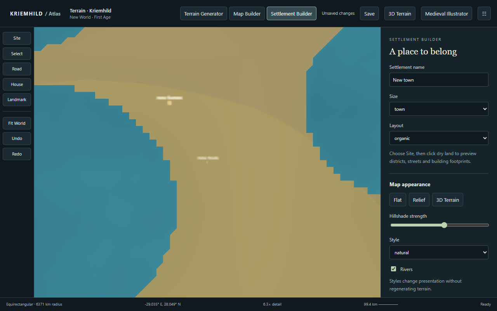

# Viewport rendering and climate-stage investigation

22 October 2026. Baseline: `rebuild/continuous-terrain`, commit `2e4f5e4` (`fix: zoom resolution`). The previous investigation's changes are present. This report distinguishes reproduced failures from the unidentified contents of the user's unsaved preview.

## Result and scope

The shared Terrain Generator, Map Builder and Settlement Builder now use an atomic viewport renderer. A lazy terrain pyramid supplies the existing geographic samples; one complete image per raster layer is committed together. The original renderer remains available only through `?terrainRenderer=tiles` for regression comparisons. Source resolution, coordinate conventions, terrain generation and hydrology were not changed.

Climate version 1 now has an explicit climate-regime stage followed by vegetation selection. Its validated behavior is preserved: six complete worlds have identical before/after climate statistics, biome/connectivity statistics and all 36 diagnostic PNG hashes. Version 0 remains unchanged. No biome quotas, relabeling campaign, migration or regeneration of user worlds was introduced.

**Identification correction:** the supplied URL is `/world/new?world=55815c1c9264170f1e4dc6076b0300a5&age=29707595f0daafd73a8246dafc832771`, for “The Ordered World / First Age.” That route opens a new-generation workspace; the query parameters identify the acceptance destination. Read-only database inspection found no attached terrain or map for that Age. The separately saved project `ae7e539f0fba71dad0417df2186d0ac8` is continuous-1, climate version 0, seed `8fef5907901a`, rainfall/relief 1/1. It is **not established as the unsaved preview in that URL**. Earlier commentary inferred that association too broadly. The preview's exact seed/version cannot be recovered from the supplied URL alone.

All authoring tests used disposable data on ports 8125 and 8126. The saved legacy project was read from a consistent SQLite backup. The original database and user server on port 8124 were not modified by authoring/API tests.

## Confirmed rendering failure and ruled-out hypotheses

The original renderer publishes individual parent/child images independently, and the base and hillshade layers have independent request queues. Only the base layer reports loading/failure to the footer. Consequently the interface can say **Ready while shading still contains lower-resolution parent rectangles or missing children**. Held/failed shading children reproduce that state; camera movement can retain it after the request has exhausted retries. This is a confirmed failure mode, not proof that every rectangle in an unavailable original screenshot has that cause.

The baseline uses 1280×800, DPR 1, SVG 892×695, natural + 0.55 hillshade, fixed seeds and revision 0. The first two zoom gestures produce complete natural z2 coverage but 10 sampled screen positions without matching z2 hillshade, after network idle and while Ready. During the controlled z6 shading delay the fresh world's corresponding count is 443. These are missing **requested-detail coverage**, not necessarily transparent holes. The underlying parent can remain visible. See [baseline gate](BASELINE.md), [fresh baseline requests/states](baseline/new.json), [legacy baseline](baseline/old.json), and the matched [viewport sequence](prototype/new.json).

Tests did not establish a new frontend/backend coordinate disagreement, swapped parent/child bounds, missing sampling halo, or authoritative geographic discontinuity. Equirectangular coordinates still span x=[0,2], y=[0,1]. Actual SVG letterboxing is included. Adjacent independent halo samples agree, including the longitude seam. At equal sample density a 512-pixel parent equals four 256-pixel children pixel-for-pixel for natural, biome, mask, elevation, hillshade and shoreline ink, for both continuous-1 and continuous-3. Existing strict revision rejection, dirty-region cache reuse and cancellation tests pass.

These results support changing publication granularity while retaining the existing sampler, power-of-two addressing, fallback concept and backend concurrency. They do not justify reducing the 4096×2048 source, increasing concurrency, rewriting terrain generation or erasing authored edits.

## Architecture and implementation

`terrain-pyramid.js` separates the immutable terrain source, cached internal representations and a complete viewport transaction:

1. `viewportRequest` uses the same `visibleViewport` transform as entity placement and the existing projected-pixel LOD selection. Output dimensions retain DPR, capped at the existing DPR 3 policy. Tile sizes remain 256/512; geographic upper bounds are exclusive.
2. `TerrainPyramid` lazily caches raster representations of the backend's authoritative physical halo samples at power-of-two levels. It is not a newly generated global heightfield and does not invent local geography. Encoded-node storage has a 64 MiB LRU budget. Identity includes source/session, revision lineage, dirty-region stamp, style, z/x/y and sample size. Unknown revision history invalidates all dependent identities; known local edits reuse unaffected nodes.
3. `renderViewport` obtains a complete coarse level (z−2 where applicable), then the requested level. The coarse preview uses correspondingly fewer output pixels; final output retains every requested pixel. For each layer it places nodes into an integer-addressed CPU-backed offscreen atlas and resamples the assembled atlas once into the complete viewport. Three workers total are used across styles. PNG nodes never become individually visible DOM images.
4. `ViewportSurface` decodes every layer before a single state commit. Generation identities and abort signals prevent late requests or late image decoding from replacing the latest camera. The previous complete frame stays at its geographic coordinates until replacement. A new source identity hides incompatible imagery. Coarse frames remain explicitly loading until final detail succeeds.
5. `ViewportLayer` supplies synchronized base, shading and authored shoreline layers to their original positions among interactive vectors. Entity controls, labels, rivers and illustration objects remain interactive SVG elements. Export still obtains terrain at its requested export density.

Atlas storage is limited to 64 megapixels and output to 32 megapixels, with an explicit failure/retry state rather than silent downsampling. Temporary canvas storage and decoded bitmaps are released on success, failure and cancellation. Committed/obsolete blob URLs are released; a component test verifies no retained URLs after unmount.

The prototype's failure test caught a new UI feedback problem: a normal-size retry button changed footer height, causing a new camera request. The footer control now fits the existing height, and rendering errors have separate state from save errors. Nine injected failed attempts (three workers × three attempts) terminate without further requests during the stability observation, retain the last image and recover through Retry. This diagnostic repair was validated before default adoption.

## Matched visual and interaction evidence

Original renderer, complete close view:



Viewport renderer, same geographic camera and revision:



The [prototype directory](prototype/) contains global, intermediate, held-child, deeper zoom, pan, zoom-out/return and reload captures for both source generations. Compare the original [delayed shading / false Ready](baseline/new-04-delayed-shading.png) with the [complete coarse viewport / loading](prototype/new-04-delayed-shading.png). The [integration directory](integration/) records landmark placement, terrain raise, Undo, Redo and reload. [Stress results](stress/results.json) record persistent 503 recovery, rapid obsolete style requests, all 21 UI styles, illustration and 1920×1080 windows at DPR 2 and 3. Each committed raster layer has the same bounds, generation and revision.

Real Canvas tests compare a diagonal river/circular land pattern assembled from independent nodes against one continuous authoritative raster covering the same absolute sample extent, using the same resampling backend. Global, fractional interior and world-edge cases match exactly. [Numeric evidence](stress/results.json). CPU and GPU interpolation themselves are not bit-identical: a cross-backend comparison produced up to 11/255 differences near antialiased edges ([record](raster-cross-backend.json)). CPU resampling a whole-world image versus a cropped source extent also rounded 57 channel values differently (maximum 8/255), on fractional columns unrelated to tile boundaries ([record](raster-source-extent-rounding.json)). Both experiments were retained. The continuity test controls source extent and rasterization rather than loosening its one-value tolerance; geographic bounds and absolute samples are checked independently. Equal-density source/parent/child tests remain exact. No extra blur, geography cropping in the application, or source-resolution reduction is used to hide seams.

## Climate activation, diagnostics and compatibility

New UI/API generation uses continuous-3 and climate version 1. Existing saved files retain their own specification. `BiomeAt` selects the version-1 seasonal path only when both the climate version and active generator version match; continuous-1 uses the frozen original annual classifier. This is intentional compatibility behavior, not an automatically migrated field.

The separately saved continuous-1 project was decoded without generation. Its dry land is 21.48% steppe, 5.14% desert, 14.32% forest and 17.99% rainforest. That classifier has no temperate-rainforest outcome. [Saved-field diagnostics](saved-world/8fef5907901a.json) and [saved biome map](saved-world/8fef5907901a-biome.png). This rules out attributing every reported rainforest category to that saved project.

Paired current-generator experiments keep settings identical within each pair. Defaults are rainfall 1.65, relief 0.8 and source width 4096. Values below are percentages of **dry land**, excluding ocean and lakes and weighted by cos(latitude):

| Seed | Forest v0→v1 | Steppe v0→v1 | Desert v0→v1 | Temperate rainforest v0→v1 | Tropical rainforest v0→v1 | Shrubland v0→v1 |
|---|---:|---:|---:|---:|---:|---:|
| Kriemhild | 8.4→11.9 | 14.3→7.8 | 2.3→1.3 | 4.4→5.0 | 14.6→13.1 | 3.4→8.6 |
| gallery-001 | 8.7→11.1 | 9.8→5.7 | 3.3→2.7 | 5.8→6.7 | 19.9→17.4 | 3.1→7.4 |
| gallery-002 | 4.2→6.6 | 12.7→9.5 | 5.7→4.0 | 3.7→4.0 | 12.9→12.0 | 1.4→5.8 |
| 8fef5907901a | 6.9→10.8 | 15.8→10.4 | 7.5→6.0 | 2.7→3.5 | 10.6→10.0 | 3.1→8.9 |
| gallery-003 | 5.6→9.2 | 14.2→8.5 | 4.5→3.0 | 3.6→4.2 | 14.0→13.0 | 2.3→7.4 |
| gallery-004 | 7.4→11.7 | 15.6→8.4 | 2.3→1.3 | 2.5→3.6 | 7.8→6.7 | 2.6→9.2 |

These are **version comparisons**, not changes caused by this refactor. The refactor's v1 before/after columns are identical in every case. [Full comparison and hashes](climate-comparison.json). The first three v0/v1 baselines are retained from the previous investigation; the additional three were generated before changing the classifier in this investigation.

A separate pair uses the saved project's seed **and rainfall/relief 1/1** with continuous-3: v0→v1 forest 4.1→7.8%, steppe 22.3→16.9%, desert 11.7→9.6%, tropical rainforest 8.7→8.1%, temperate rainforest 2.6→2.5%. The lower rainfall setting legitimately remains drier. This is not a direct old-project migration comparison: continuous-1 and continuous-3 terrain/hydrology differ. Version changes also alter lake coverage through climate/hydrology feedback, so dry-land denominators are reported separately rather than presumed identical. No hydrology code was changed.

`ClimateRegimeAt` expresses independent thermal, moisture and rainfall-seasonality axes using persisted monthly summaries, with a monthly fallback for synthetic/older incomplete fixtures. `vegetationAt` has explicit precedence: cold limits, exposed alpine conditions, aridity, Mediterranean summer drought, steppe, wetlands, tropical moisture regimes, grassland, boreal forest, temperate rainforest, woodland and forest. It preserves the established annual units and version-1 thresholds. Temperature/precipitation transport were not retuned because the current controlled tests did not demonstrate a further specific deficiency warranting that change.

Evidence includes monthly temperature/precipitation atlases, annual fields, PET/aridity, slope/elevation summaries, latitude bands, connected-component counts/largest-region shares and separate lake coverage. Monthly atlases run January–December left-to-right in four columns, three rows. Temperature uses a fixed −40 to +40°C scale; rainfall a fixed 0–300 mm/month scale; blue is low, red high. Values outside display scales clip only in those diagnostic images. Numeric distributions retain full values. See [final six-seed diagnostics](climate-v1-final/).

The climate-stage tests include 8,000 comparisons with the frozen pre-refactor classifier, named continental/Mediterranean/steppe/desert/maritime/tropical/boreal/tundra cases, cached-summary and monthly paths, wet/cold/highland cases, hemispheres and smooth moisture gradients. Archive/cold-restart tests explicitly verify climate version and full monthly/summary grids; a version-0 round trip verifies no silent migration.

## Performance, regression and adoption decision

**Adopt the optimized viewport path**, with explicit high-DPI memory limits. Correctness and normal-viewport latency favor it; large-DPI memory remains a documented cost rather than a claimed improvement.

Three repetitions per renderer/source, identical camera sequence, 1280×800 / DPR 1. Median milliseconds from gesture sequence to complete requested detail, including gesture delays and the debounce:

| Source / renderer | Global | Regional | Close | Zoom out | Return |
|---|---:|---:|---:|---:|---:|
| continuous-3 / tiles | 486 | 1845 | 2047 | 1092 | 1685 |
| continuous-3 / viewport | 296 | 1132 | 1188 | 935 | 1069 |
| continuous-1 / tiles | 366 | 1616 | 2048 | 1142 | 1580 |
| continuous-1 / viewport | 293 | 1161 | 938 | 985 | 952 |

All 60 stage captures completed without browser exceptions. The summary script asserts exact camera/dimension equality across repetitions and both implementations. [Raw requests, frame timings, cache counters and output sizes](benchmark/results.json), [summary](performance-summary.json). These runs use fresh browser contexts and reused server caches; per-response cache headers are recorded. They are not repeated cold-server generation benchmarks. Frame timings separately measure coarse/final transactions; obsolete requests are recorded rather than included as successful completions.

Large-DPI testing revealed excessive native canvas retention. Two targeted changes were retained: coarse output uses its actual coarse density, and PNG assembly uses CPU-backed canvases (`willReadFrequently`). A complete fine frame still has 4596×2925 pixels in the 1920×1080/DPR 3 fixture. The earlier full-DPI coarse frame alone retained about 103 MiB decoded; the optimized coarse frame uses about 6.4 MiB. No final detail is removed.

Three matched warm-server DPR 3 global-view measurements, including all Chromium processes belonging to each isolated test browser:

| Implementation | Working set before explicit GC | Retained working set after GC | Final transaction |
|---|---:|---:|---:|
| Original tiles | 855–863 MiB | 712–719 MiB | Per-tile publication |
| Viewport with GPU-backed assembly | 1831–1932 MiB | 1590–1690 MiB | 2.48–2.53 s |
| Viewport with CPU-backed assembly | 1179–1190 MiB | 940–948 MiB | 2.36–2.41 s |

See `memory-final-*.json` and `memory-software-final-*.json`. The CPU assembly experiment used the same context option now present in the renderer. These are browser process working sets, not total dedicated GPU VRAM. Per-process lifetime peaks are also recorded; summing them gives an upper bound, not a simultaneous aggregate peak. The original initial memory attempt mixed cold work with a 60-second observation limit; its incomplete flag and eventual final-frame metadata are preserved in `browser-memory-initial.json`, not treated as a matched performance success. Cold large-DPI detail took roughly 50–69 seconds in initial observations; warm timing must not be presented as that cold latency.

The optimized viewport therefore still costs about 225 MiB more retained browser memory in this large-DPI fixture. Normal-view completion is faster, browser terrain image count drops to two, and revision/layer publication is coherent. Further reduction of large offscreen storage is a future optimization; concurrency and terrain resolution were not increased. The 32/64-megapixel limits make excessive requests explicit failures, and the 64 MiB node cache remains bounded.

The climate refactor's microbenchmark exposed unnecessary full moisture reads on the cold-limited path (about 550 ns versus the previous 229 ns in that synthetic case). Vegetation now stops after thermal classification when later fields cannot affect the outcome, while diagnostic regime queries still return all axes. The optimized path measured approximately 266–309 ns; temperate/tropical stage measurements remain slightly slower than the old monolithic function. Output equivalence is tested independently; no claim of climate-generation speedup is made. Full-world generation/tile timings and live Go heap are retained in each audit JSON, but those diagnostic runs overlap other validation and are not used to claim controlled speed improvements.

| Validation | Result |
|---|---|
| JavaScript suite | 90 tests, including pyramid/component tests and existing persistence/coordinate/request regressions. |
| Active Go terrain and HTTP API suites | Passed; additional final climate-equivalence, version-0 and both-generator continuity tests passed. |
| Production build and targeted Go vet | Passed. |
| UI structure checks | Passed. Global formatting still flags only the pre-existing untouched `Biosphere.jsx` and `BiosphereEditors.jsx`. |
| Browser authoring | Landmark coordinates unchanged after pan/zoom; terrain edit, Undo, Redo, save/reload passed. |
| Cold server restart and settlement | Disposable server restarted with the changed source; site coordinates, accepted settlement geometry and subsequent pan/zoom remained correct. SVG export 1,846,619 bytes; PNG export 110,375 bytes. [Evidence](integration/settlement-audit.json). |
| Climate compatibility | Six-seed fields/distributions/connectivity and 36 PNG hashes unchanged; monthly-summary/archive/cold-start and frozen-v0 tests passed. |

Logs are retained in [regression](regression/). The full active Go suite preceded the small cold-path optimization; the final equivalent-classifier/version-0 tests and a repeat complete-world audit for `8fef5907901a` validate that final optimization. The untouched legacy Go package's previously documented long-running timeout was not reclassified as a passing result or rerun merely to repeat that known unrelated failure. No claim is made that every repository check is green.

## Files and reproduction

| Files/functions | Purpose |
|---|---|
| `src/continuous/terrain-pyramid.js`: `viewportRequest`, `pyramidNodes`, `TerrainPyramid`, `renderViewport` | Lazy bounded pyramid cache, geographic coverage, complete coarse/fine transactions and instrumentation. |
| `src/continuous/ViewportSurface.jsx`: `ViewportSurface`, `ViewportLayer` | Atomic decoded image publication, cancellation, context shared by illustration layers and URL lifetime. |
| `src/continuous/Studio.jsx`, `studio.css` | Default shared renderer, explicit diagnostic fallback, stable failure/retry UI. |
| `internal/terrain/generate/climate_regime.go`, `biome.go` | Separate climate regimes from vegetation; preserve exact v1 outputs and frozen v0 path. |
| `cmd/climate-audit/main.go` | Read saved planet data without generation; configurable paired settings, regime shares and monthly maps. |
| `internal/terrain/generate/climate_regime*_test.go`, `generate_test.go` | Frozen-classifier equivalence, named climate regimes and v0 persistence. |
| `internal/httpapi/continuous_test.go`, `internal/terrain/tiles/continuity_test.go` | Explicit climate-version archive/cold-start assertions and both-generator shared-edge/equal-density comparisons. |
| `tests/terrain-pyramid.test.mjs`, `viewport-surface.test.mjs` | Bounds, LOD coverage, revision lineage, budgets, cancellation, failed coarse fallback, atomic decode and URL release. |
| `tests/viewport-*.mjs`, `viewport-climate-comparison.py`, extended continuous investigation helpers | Repeatable browser evidence, fault injection, pixel comparisons, performance/memory and six-seed hash/stat comparison. |

Use a disposable server and disposable saved fixtures. The scripts intentionally edit and save their test worlds.

```powershell
$env:KRIEMHILD_BROWSER_EXECUTABLE='C:/Users/tomyi/AppData/Local/ms-playwright/chromium-1243/chrome-win64/chrome.exe'
./.tools/go/bin/go.exe run ./cmd/kriemhild -addr 127.0.0.1:8125 -data .cache/terrain-investigation
# Separate terminal: baseline creates a new fixed-seed disposable world.
node tests/viewport-baseline.mjs
node tests/viewport-prototype.mjs
node tests/viewport-stress.mjs
node tests/viewport-benchmark.mjs
node tests/viewport-memory.mjs
$env:KRIEMHILD_AUDIT_WORLD='<disposable-project-id>'
$env:KRIEMHILD_AUDIT_RENDERER='viewport'
$env:KRIEMHILD_AUDIT_OUT='docs/viewport-investigation/integration'
node tests/run-continuous-investigation.mjs
node tests/run-continuous-settlement-investigation.mjs
npm.cmd test
./.tools/go/bin/go.exe test ./internal/terrain/... ./internal/httpapi -timeout 8m
./.tools/go/bin/go.exe run ./cmd/climate-audit -seeds Kriemhild,gallery-001,gallery-002,8fef5907901a,gallery-003,gallery-004 -out docs/viewport-investigation/climate-v1-final
python tests/viewport-climate-comparison.py
```

`AUDIT_OLD=1` runs the matching legacy-source sequence on a disposable port-8126 SQLite backup (`-data .cache/viewport-source-copy`). Create that backup with SQLite's backup API using a read-only source connection, not by modifying or regenerating the original. Baseline/prototype/stress/memory scripts share the recorded fixture IDs; environment overrides select a different disposable fixture. `MEMORY_DPR=3`, `MEMORY_RENDERER=viewport`, `MEMORY_SOFTWARE=0/1` and `MEMORY_OUT=<file>` reproduce the controlled canvas-backing comparison; the default renderer now uses CPU backing. Run authoring scripts sequentially: simultaneous editors can conflict on the same saved project revision. Request logs are bounded and distinguish camera obsolescence, HTTP failures, retries, cache status and complete coarse/final frame publication.

## Remaining limits

- The user's original unsaved preview seed/revision and exact failing camera are unknown. This work reproduces and fixes the documented independent-layer/partial-publication failure on controlled worlds; it cannot establish that all possible artifacts in that preview had the same cause.
- Chromium, six default seeds, one lower-rainfall pair and one saved legacy project do not cover all browsers, devices or planet settings. Large high-DPI cold views can be expensive; explicit budgets preserve correctness instead of silently lowering quality.
- A complete previous viewport can expose unpainted newly panned space until a complete coarse replacement is ready. It is labelled loading and is not stretched onto the new geography. No partial new-detail rectangles are committed.
- Cross-tab authored changes are rejected by strict revision checks; automatic multi-editor revision synchronization is outside this change. A view with a remote revision conflict must reopen current state. Tests use one editor at a time for saved-view authoring.
- The simplified climate model lacks explicit ocean currents and a calibrated conserved planetary energy/moisture budget. Very wet extremes, cold high latitudes and lake coverage remain model properties. Existing biome identifiers represent broad forest/woodland/shrubland categories, not a species-level ecology or a promise of European vegetation everywhere.
- The old renderer is retained only as a diagnostic reference for continuing cross-browser and device-memory comparisons, not as a second default production path.
